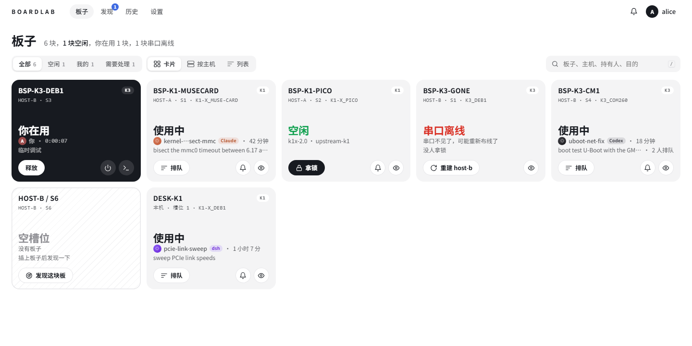
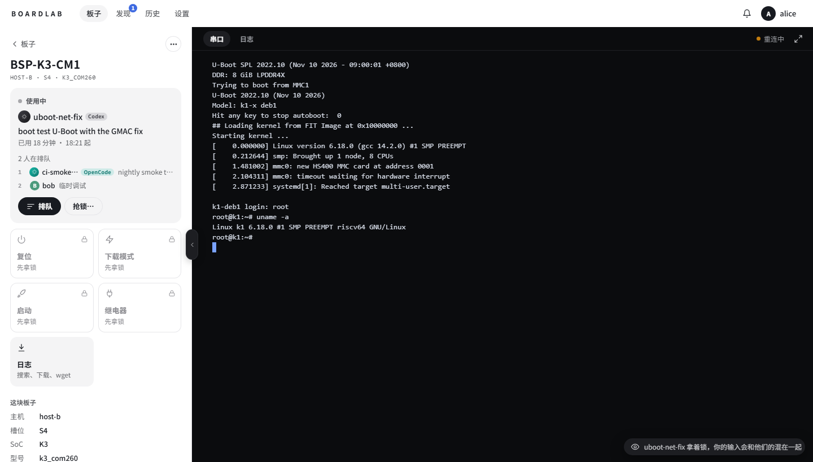
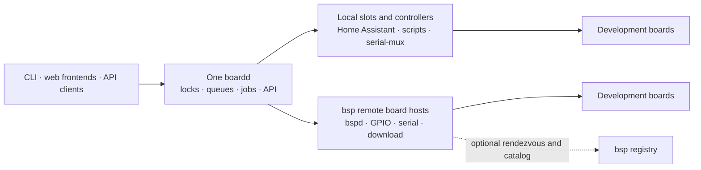

# better-boardlab

An open-source control plane for shared development-board labs. One `boardd` service coordinates boards, locks, serial
consoles, boot and flash jobs, and build-server SDK work through the `boardlab` CLI, a web interface, and an HTTP API.
The `boards` command is an alias for `boardlab`.

better-boardlab is a distribution of [boardlab-core](https://github.com/rzbdz/boardlab-core) with modules for local
slots, board-host integration, SDKs, and the supporting lab workflows.

## Capabilities

- Share boards with persistent locks, a first-come queue, and an activity history.
- Reset boards, enter download mode, use serial consoles, and inspect searchable serial logs.
- Load FSBL, bootloaders, and kernels into RAM without issuing persistent-storage writes; the booted firmware or OS may still write storage.
- Flash an SDK build or an explicit image package when persistent changes are intended.
- Address physical slots independently of the board currently installed in them.
- Control local slots through Home Assistant switches or user-provided scripts.
- Use bsp-managed remote board hosts for GPIO, serial, download, and SDK artifact workflows.
- Build and work in SDK source trees on configured build servers.
- Coordinate physical bench tasks through persistent human-operation requests.
- Use replaceable web frontends and a documented OpenAPI 3.1 interface.



| Board controls beside its serial console | Board discovery by host |
| --- | --- |
|  |  |

## Architecture



boardd is the sole boardlab control plane. Clients connect to it directly over HTTP(S), or through SSH forwarding.
Local controller modules and remote bsp backends provide board access behind the same commands. The optional bsp
registry provides host rendezvous and SDK/catalog distribution; it does not own boardlab boards, locks, queues, or web
sessions. See [Board hosts](docs/help/board-hosts.md) and [Clients](docs/help/clients.md) for the transport boundaries.

## Install

On the machine that will run boardd:

```sh
curl -fsSL https://github.com/rzbdz/better-boardlab/releases/latest/download/install.sh | sh
```

The installer places boardlab in `/opt/boardlab`, keeps state in `/var/lib/boardlab`, starts the `boardd` service, and
prints its address. It installs Node.js 24 when needed. Run `install.sh --help` for service, CLI-only, offline, and
reverse-proxy options. Board hosts, SDK sites, and client machines can then be configured on the web settings page.

**Security:** boardd has no built-in user authentication and can control boards and execute configured slot scripts as
its operating-system user. Keep it on a trusted network; use an authenticating reverse proxy when exposing it more
broadly. Locks coordinate work but are not a security boundary. Read the [threat model](docs/security.md) before
changing the listen address or granting access.

## Command line

```sh
boardlab list
boardlab lock board1 --for "debug U-Boot"
boardlab reset board1
boardlab console board1
boardlab unlock board1
```

On another machine, install the CLI and connect it to the same boardd:

```sh
boardlab remote set ssh://<user>@<boardd-host>
boardlab status
# Or use an HTTP(S) reverse-proxy address:
boardlab remote set https://example.org/boardlab/
```

Use `boardlab remote show` to inspect the active endpoint and `boardlab help` for all commands. `boardlab install`
installs the optional agent skill in the current working directory.

**RAM boot:** `boardlab boot` loads images into memory; it does not by itself flash storage. Image order and required
bootloader stages depend on the board and SDK. `boardlab flash` is a separate operation that modifies persistent
storage. See the [guide](docs/guide.md) and [skill boot notes](skills/boardlab/boot.md).

## Documentation

- [Guide](docs/guide.md): slots, locks, scans, remote labs, SDK workflows, and reverse proxies (Chinese).
- [Clients](docs/help/clients.md) and [board hosts](docs/help/board-hosts.md): client and host configuration.
- [Human requests](docs/help/human.md) and [SDK instances](docs/help/sdk-instances.md): assisted bench work and SDKs.
- [Security](docs/security.md): deployment boundaries and credential handling (Chinese).
- [Releases](docs/releases.md): versioning, build artifacts, publishing, and retention.
- [Contributing](CONTRIBUTING.md) and [vulnerability reporting](SECURITY.md).
- `boardlab help`: CLI commands; `GET /api/openapi.json`: the running boardd's HTTP interface.

## Development

Requirements: Node.js 24 or newer and pnpm.

```sh
git clone --recurse-submodules https://github.com/rzbdz/better-boardlab.git
cd better-boardlab
pnpm install
pnpm run build
node dist/cli.js serve  # http://127.0.0.1:38127/
```

Validate changes with:

```sh
pnpm run typecheck
pnpm check
pnpm run build
pnpm test
```

A module in `src/modules/<id>/` has a server entry (`index.ts`/`catalog.ts`), optional CLI commands (`cli.ts`), and
optional frontend-neutral views (`ui.ts`). Run `pnpm modules` after adding or removing a module to regenerate the
registries. Frontends in `frontends/<name>/` render those views without importing module internals.

The kernel, backend contract, gateway, CLI framework, and client library belong to boardlab-core. The bsp host tools
belong to [boardctrl](https://github.com/rzbdz/boardctrl). Both are submodules here: change them in their own
repositories, then update the gitlinks. `architecture.json` defines and enforces the module boundaries.

## Origin and license

boardlab began as a project by [Troy Mitchell](https://github.com/TroyMitchell911). better-boardlab is a substantial
rework built around a product-independent core, replaceable distributions, remote labs, and bsp integration.

Released under the [MIT License](LICENSE); the original copyright notice is retained.
