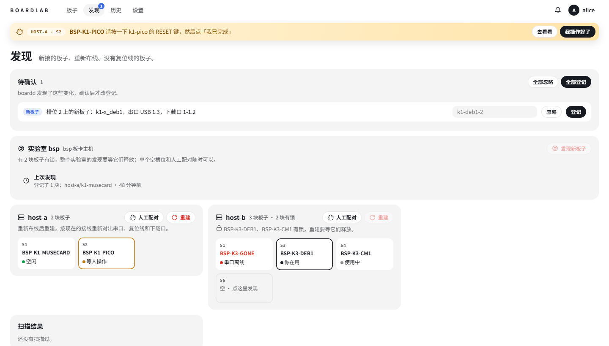
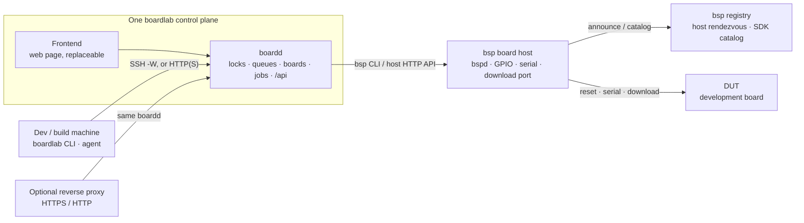

# better-boardlab

A shared lab for development boards. People and AI agents lock a board, reset it, open its serial console and boot it from RAM, through one service, one command line and one web page.

better-boardlab is a distribution of [boardlab-core](https://github.com/rzbdz/boardlab-core) that bundles a set of useful modules:

- **Boards on this machine**:
  - slots reset by Home Assistant switches or by your own scripts
  - serial consoles through serial-mux, and fastboot
  - a one-click scan that finds and identifies boards
- **Remote board hosts** through [bsp](https://github.com/rzbdz/bsp-remote-dev-workflow): boards in other labs, plus building and booting SDKs on build servers.
- **Flashing a package** onto a board from a link or a file, on the board's page or with `boardlab flash <board> <url|file>`.
- **A Claude skill** (`skills/boardlab`) that teaches agents the CLI.


| A board: controls beside its serial console | Discovering boards, host by host |
| --- | --- |
|  |  |

## Architecture

Four separate responsibilities. The boardlab control plane and the bsp host/catalog registry are different services: the registry does not own boards or locks.



| Part | Responsibility |
| --- | --- |
| Dev / build machine | The `boardlab` CLI and skill only. `boardlab remote set ssh://<user>@<boardlab host>` works when only SSH is allowed: the CLI uses `ssh -W` to reach the same boardd, not a shell on a board host. Where HTTP(S) is available, point it at the reverse proxy instead. No second boardd or registry is needed on the client. |
| boardd | The only boardlab control plane: locks, queues, boards, requests, history and API. The web page is a replaceable frontend. boardd runs the bsp CLI; for a directly connected board host it can use the host's HTTP API rather than a registry or an SSH tunnel. |
| bsp board host | The machine physically wired to boards. Its bspd watches ports and performs GPIO, serial, download and artifact work. An SDK artifact normally comes from the build server over SSH/SCP, HTTP(S), or an explicit `host:/absolute/path`; workstation upload is a fallback. |
| bsp registry | Optional host rendezvous and SDK/catalog distribution. It is not another boardd: it owns no boardlab locks, queues or web sessions. |
| DUT | A board in a slot, with its own reset/download wiring and serial console. |

## Features

- Board locks with a first-come queue, shared by people and agents. An agent asking for a board a person is using
  waits while the page asks the person: 让出 hands it over, 继续用 keeps it; a refused lock is in the history.
- Resets, download mode and power through relays, wired once per slot (see [Reset and power control](#reset-and-power-control)).
- The same commands for every board, wherever it is: `reset`, `fastboot`, `console`, `send`, `log`, and `boot` (load FSBL, U-Boot and a kernel into RAM).
- Slots: name a board by where it sits (`host1/s3`), and swap boards without registering them again.
- Boot recipes can carry break points (`breaker: uboot`): the board's page offers 完整启动 or 停在 uboot, for working on
  U-Boot or the kernel. A running boot or flash can be cancelled (取消, or `boardlab cancel`).
- A web page with boards, consoles, history and settings, and an HTTP API for other programs. Two frontends ship: Modern (the default) and TroyMitchellDefault. Settings picks the one this boardd serves. The Modern frontend's **API** tab lists every endpoint boardd serves, and the same list is available to programs and crawlers as OpenAPI 3.1 at `GET /api/openapi.json`.
- Registration reads are passive. GPIO choices and USB download-port choices come from the host's existing inventory and port watcher, with short-lived sharing; opening a form never runs discovery or resets a board. Saving validates the current choices. Existing form data stays visible while choices refresh in the background.
- Serial logs over any time range: search by text or regex, download in the browser, or copy a `wget` command.
- An inbox for the agents using boardlab: when an API or a design cannot do what their work needs, `boardlab feedback` files it in boardd's database; the page's 反馈 shows what waits, and `resolve <id>` closes it fixed or not taken.
- A way for agents to ask a person for the work only hands can do: `boardlab ask "plug the USB cable into 2-1.1" --body "the console prints ROM: usb download handler when it is in"` files the request and waits; the page's 人工请求 shows it, where whoever is at the bench clicks 我做好了 or 做不了 (with a note), and the agent continues with the answer. Requests live in boardd's database, so they survive restarts and updates (`GET /api/human/request?id=…&wait=20` is the same wait over HTTP).
- Browser notifications into the operating system: a board you watch is free, your turn in the queue came, a board needs a person.
- A central boardd you can reach from any machine, over ssh or through a reverse proxy.

## Reset and power control

Every slot names how its board is reset and put into download mode, and boardlab drives it with no one at the bench:

- **GPIO relay boards** on bsp board hosts, switching each board's reset and boot buttons. bsp's control backends are pluggable, so other controllers can be added.
- **Home Assistant** switches and smart plugs.
- **Your own scripts**, for any relay, PDU or USB-controlled hub you can drive from a command.

A board on a bench with no reset line wired yet, for a quick debugging session, still works: boardlab asks a person to press RESET, shows where the board is, and carries on once they confirm.

The person performing an action and the board's download-mode topology are independent settings. **Reset** can be a person or a GPIO; **FDL** can be `human`, `strapped` (reset already enters download mode), or a GPIO/button. Choosing a person adds a request, automatic detection, an idempotent confirmation and its timeout; it does not change the topology. A board already in download mode can be accepted from its existing port and retained ROM evidence, without requiring a fresh reset banner. The registration editor offers these as choices from the actual host, not free-form GPIO or USB identifiers.

## Install

On the machine that will run boardlab (as root, to set it up as a service):

```sh
curl -fsSL https://github.com/rzbdz/better-boardlab/releases/latest/download/install.sh | sh
```

It installs boardlab in `/opt/boardlab` (Node 24 is fetched if the machine has none; offline, give one with
`--node <node or its tarball>`), keeps its state in `/var/lib/boardlab`, starts the `boardd` service, and prints its
address. Add `-s -- --host <address>` to open the page on the network. Run as another user, or with `--cli`, it
installs only the CLI under `~/.local`. `--origin https://proxy/` is the address people open when boardlab sits behind
your reverse proxy; boardd accepts the page from there, and updates keep it.

install.sh is a thin bootstrap: it fetches a release and runs that release's own setup. To install from your own
(private) repository, point it there with `--from`, a git repository's branch or a git server's project API:

```sh
curl -fsSL https://github.com/rzbdz/better-boardlab/releases/latest/download/install.sh \
  | sh -s -- --from https://git.example/api/v4/projects/<id>#release --token <token>
```

`--from` also takes `git@host:group/repo.git#release` or an https directory. Updates come from the same place; to
switch it later, use Settings → 版本 → 发布源 (检查 shows the version there, 保存 keeps it) or
`boardlab update --set-source <source> [--token T]` (`--show-source` shows it, `--from <source>` switches and updates).

Everything else is done on the page:

- **Board hosts.** Settings → bsp 板卡主机 → 添加板卡主机: give the machine's address (an IP, a DNS name, or a name from
  this machine's ssh config) and a password, or nothing when this machine's ssh keys already get in. boardlab logs in,
  puts its own key there, installs bspd (it works out the machine's GPIO header itself), and adds the host as a lab.
  The host can be this machine itself (`localhost`). Then 发现 finds the boards on it.
- **SDKs.** Settings → SDK 与站点: where each SDK lives, its build server and how it boots or flashes, kept in one site
  (managed on the page, or a git repository you pull from and push to) and synced to every board host.
- **Clients.** Settings → 客户端配置: build servers and laptops get the `boardlab` CLI installed over ssh
  and pointed at this boardd (boardd brings Node along when the machine has none).
- **Updates.** Settings → 版本 → 检查更新 / 升级, or `boardlab update`. boardd checks for a newer release every few hours
  and installs it without stopping: new connections, pages and CLIs go to the new version, while consoles, event
  streams and the tasks a board is running finish on the old one. Locks, queues and settings are kept, and the page
  reloads itself. A restart only happens when the new release cannot take over (and leaves the browser terminals and
  board activity running).
- **Terminals.** Turn on `{ "terminal": { "enabled": true } }` in `/var/lib/boardlab/boardd.json` for a 终端 tab: shells on
  the boardlab machine in tmux sessions that outlive the page.

From the command line:

```sh
boardlab list
boardlab lock board1 --for "debug U-Boot"
boardlab reset board1
boardlab console board1
boardlab unlock board1
```

On other machines (build servers, laptops), install the CLI the same way as a normal user and point it at boardlab:
`boardlab remote set ssh://<user>@<boardlab host>`. To install the skill for an agent, run `boardlab install` in the
agent's working directory, or `boardlab install -g` for every agent on the machine.

### From source

Requires Node.js 24 or newer and pnpm.

```sh
git clone --recurse-submodules https://github.com/rzbdz/better-boardlab.git
cd better-boardlab
pnpm install
pnpm run build
node dist/cli.js serve             # http://127.0.0.1:38127/
node scripts/release.mjs --source <where>   # release/install.sh, the tarball, CHANGELOG.md and release.json
node scripts/publish.mjs git <repo>         # the release branch, its CHANGELOG.md and a v<version> tag
node scripts/publish.mjs github <owner/repo>  # a GitHub release, with the changelog; the newest 3 are kept
```

The changelog is the commits since the previous release. A GitHub release carries it as its notes and deleting older
releases deletes their tarballs too (like an installed machine, which keeps the newest three under `releases/`).

## Configuration

boardd loads every module by default. To load only some of them, write `boardd.json` in its state directory (`~/.local/state/boardlab`):

```json
{ "modules": { "bsp": { "instances": ["bsp"] } } }
```

Remote bsp labs need the bsp CLI (`externals/bsp`). A directly reachable host uses `bspd+http://<host>:8765`; `bspd+ssh://<user>@<host>:8765` reaches a loopback-only bspd through SSH. An optional bsp registry can provide host rendezvous and the SDK/catalog site. See [Board hosts](docs/help/board-hosts.md) and [Clients](docs/help/clients.md).

## Documentation

- [Guide](docs/guide.md) (in Chinese): slots, labs, locks, RAM boot, scans, modules, remote use
- [Security](docs/security.md) (in Chinese)
- `boardlab help` lists every command

## Development

```sh
pnpm run typecheck
pnpm check     # layering and module registries
pnpm test
```

A module lives in `src/modules/<id>/`:

- `index.ts` sets it up on the core;
- `catalog.ts` offers it to boardd;
- `cli.ts` adds commands;
- `ui.ts` describes its part of the page as views (`src/ui/contract.ts`): sections, forms, actions, long jobs with progress, live streams. Every frontend renders them its own way.

After adding or removing a module, run `pnpm modules`. Changes to the core go into boardlab-core.

Each frontend is a whole page of its own in `frontends/<name>/` (`page.tsx`, `index.html`, styles), listed in `frontends/frontends.json` with the default. `pnpm run build` builds them all into `dist/ui`. Frontend tests run in jsdom against a mock boardd (`tests/mock-boardd.ts`), with no hardware.

## Origin and changes

boardlab began as a project by [Troy Mitchell](https://github.com/TroyMitchell911), released under the MIT license; his copyright notice is kept in [LICENSE](LICENSE). better-boardlab is a substantial rework of that project. The major changes from the original:

- **A core with no products in it.** [boardlab-core](https://github.com/rzbdz/boardlab-core) knows backends only through one contract and names no product. Backends, slot drivers, commands and page sections are modules, and an architecture check keeps those boundaries.
- **Distributions.** A boardlab distribution is boardlab-core plus a chosen set of modules. Different labs ship different module sets without forking the core.
- **Remote labs and slots.** Boards on remote board hosts, named by slot. A board can be swapped without registering it again, and it can boot from its own media.
- **bsp integration.** Remote board hosts, SDK builds and boots run on [bsp](https://github.com/rzbdz/bsp-remote-dev-workflow).

## License

MIT, see [LICENSE](LICENSE).
