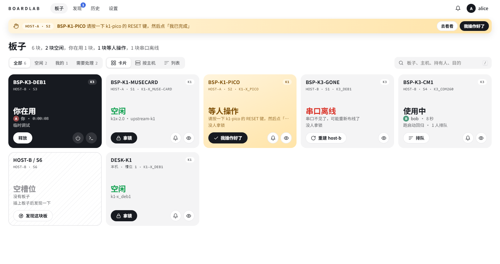
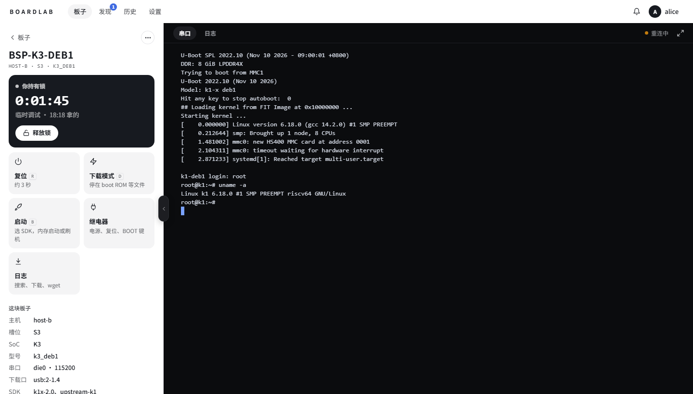
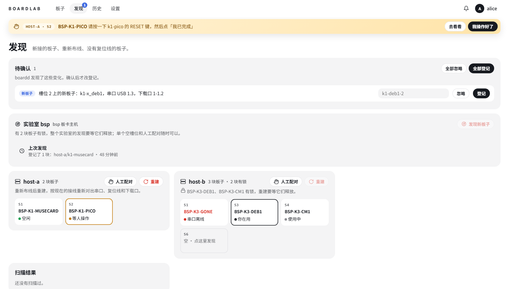
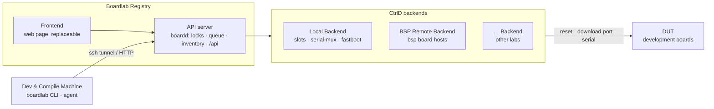

# better-boardlab

A shared lab for development boards. People and AI agents lock a board, reset it, open its serial console and boot it from RAM, through one service, one command line and one web page.

better-boardlab is a distribution of [boardlab-core](https://github.com/rzbdz/boardlab-core) that bundles a set of useful modules:

- **Boards on this machine**:
  - slots reset by Home Assistant switches or by your own scripts
  - serial consoles through serial-mux, and fastboot
  - a one-click scan that finds and identifies boards
- **Remote board hosts** through [bsp](https://github.com/rzbdz/bsp-remote-dev-workflow): boards in other labs, plus building and booting SDKs on build servers.
- **A Claude skill** (`skills/boardlab`) that teaches agents the CLI.



| A board: controls beside its serial console | Discovering boards, host by host |
| --- | --- |
|  |  |

## Architecture

Four separate parts: each box is one kind of machine (or a board), and they connect only through the interfaces on the arrows.



| Part | What it is |
| --- | --- |
| Dev & Compile Machine | Only the `boardlab` CLI and the skill, pointed at the registry. It needs no knowledge of the hosts. |
| Boardlab Registry | boardd: every request from people and agents arrives here (locks, queue, inventory, API). The web page is one frontend on the API. |
| CtrlD backends | The machines wired to the boards: this machine's own boards (Local), remote bsp board hosts, and others. Each is a boardd module. |
| DUT | The development boards, each with a reset line, a download port and a serial console, sitting in a slot. |

## Features

- Board locks with a first-come queue, shared by people and agents.
- The same commands for every board, wherever it is: `reset`, `fastboot`, `console`, `send`, `log`, and `boot` (load FSBL, U-Boot and a kernel into RAM).
- Slots: name a board by where it sits (`host1/s3`), and swap boards without registering them again.
- A web page with boards, consoles, history and settings, and an HTTP API for other programs. Three frontends ship: Modern (the default), Ant Design and TroyMitchellDefault. Settings picks the one this boardd serves.
- Serial logs over any time range: search by text or regex, download in the browser, or copy a `wget` command.
- Browser notifications into the operating system: a board you watch is free, your turn in the queue came, a board needs a person.
- A central boardd you can reach from any machine, over ssh or through a reverse proxy.

## Quick start

Requires Node.js 24 or newer and pnpm.

```sh
git clone --recurse-submodules https://github.com/rzbdz/better-boardlab.git
cd better-boardlab
pnpm install
pnpm run build
node dist/cli.js serve             # http://127.0.0.1:38127/
```

Open the page, configure slots under **Settings**, then run a scan. From the command line:

```sh
boardlab list
boardlab lock board1 --for "debug U-Boot"
boardlab reset board1
boardlab console board1
boardlab unlock board1
```

To install the skill for an agent, run `boardlab install` in the agent's working directory, or `boardlab install -g` for every agent on the machine.

## Configuration

boardd loads every module by default. To load only some of them, write `boardd.json` in its state directory (`~/.local/state/boardlab`):

```json
{ "modules": { "bsp": { "instances": ["bsp"] } } }
```

Remote bsp labs need the bsp CLI (`externals/bsp`) and a bsp site that lists your hosts; see the bsp documentation.

## Documentation

- [Guide](docs/guide.md) (in Chinese): slots, labs, locks, RAM boot, scans, modules, remote use
- [Security](docs/security.md) (in Chinese)
- `boardlab help` lists every command

## Development

```sh
pnpm run typecheck
pnpm check     # layering and module registries
pnpm test
```

A module lives in `src/modules/<id>/`:

- `index.ts` sets it up on the core;
- `catalog.ts` offers it to boardd;
- `cli.ts` adds commands;
- `ui.ts` describes its part of the page as views (`src/ui/contract.ts`): sections, forms, actions, long jobs with progress, live streams. Every frontend renders them its own way.

After adding or removing a module, run `pnpm modules`. Changes to the core go into boardlab-core.

Each frontend is a whole page of its own in `frontends/<name>/` (`page.tsx`, `index.html`, styles), listed in `frontends/frontends.json` with the default. `pnpm run build` builds them all into `dist/ui`. Frontend tests run in jsdom against a mock boardd (`tests/mock-boardd.ts`), with no hardware.

## Origin and changes

boardlab began as a project by [Troy Mitchell](https://github.com/TroyMitchell911), released under the MIT license; his copyright notice is kept in [LICENSE](LICENSE). better-boardlab is a substantial rework of that project. The major changes from the original:

- **A core with no products in it.** [boardlab-core](https://github.com/rzbdz/boardlab-core) knows backends only through one contract and names no product. Backends, slot drivers, commands and page sections are modules, and an architecture check keeps those boundaries.
- **Distributions.** A boardlab distribution is boardlab-core plus a chosen set of modules. Different labs ship different module sets without forking the core.
- **Remote labs and slots.** Boards on remote board hosts, named by slot. A board can be swapped without registering it again, and it can boot from its own media.
- **bsp integration.** Remote board hosts, SDK builds and boots run on [bsp](https://github.com/rzbdz/bsp-remote-dev-workflow).

## License

MIT, see [LICENSE](LICENSE).
